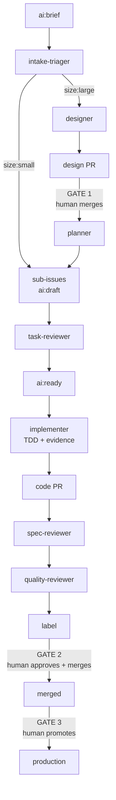

# claude-cowork

Control plane for AI-driven development at `altaprimadev`. Agents work around the clock. Humans brief, watch, and approve.

Humans do four things:

1. File a brief: run `/draft-brief <idea>` in a Claude Code session on this repo and type `post now` when the draft is ready, or use the issue form **AI brief**.
2. Watch progress: run `/inbox` for what waits on you, read the daily report, or browse GitHub. Answer agent questions with `/answer <ref>`.
3. Approve at the gates: merge design PRs (Gate 1), approve code PRs (Gate 2), promote to production (Gate 3).
4. Operators manage this repo's configuration through PRs.

## What is in this repo

| Path | Content |
|---|---|
| `CLAUDE.md` | Orchestrator rules and the stage → agent → skill map. Loads in every session. |
| `.claude/agents/` | Nine fixed agents, one per pipeline role |
| `.claude/skills/` | Nine stage skills, six stack skills, and three human-invoked skills: `draft-brief`, `inbox`, `answer` |
| `.claude/settings.json` | Guard hook and permissions, including `Skill(<name>)` allow rules |
| `.claude/hooks/guard_bash.py` | PreToolUse guard that blocks destructive Bash commands |
| `registry/` | Managed repos (`repos.yml`) and global policy (`policy.yml`) |
| `templates/` | `AGENTS.md` and `.agent/profile.yml` templates for onboarded repos |
| `.github/` | Brief form, PR evidence template, CODEOWNERS, CI, and the Project board sync workflow |
| `scripts/` | Label setup, branch protection setup, config validator, Project board sync (`project_sync.py`) |
| `tests/` | Tests for the guard hook and the Project board sync |
| `docs/` | Architecture, setup, scheduled tasks, labels, blend decisions, open questions |

This is project-level Claude Code configuration. It is not a plugin.

## How sessions use it

- Cloud scheduled tasks start every session (`docs/scheduled-tasks.md`).
- Each session uses `claude-cowork` as the main repo and adds the target repos.
- The main session acts as orchestrator. It reads labels, then delegates to one fixed agent per stage.
- Agents never approve, merge, or deploy to production. Branch protection enforces this where the GitHub plan allows it. Repos marked `branch_protection: unavailable` rely on the compensating rules in `CLAUDE.md`, the guard hook, and a human merge (`docs/setup.md`, "Current state").

## Pipeline



Details: `docs/architecture.md`, `docs/labels-and-states.md`.

## Start here

- New setup: `docs/setup.md`.
- Known limits and verified platform behavior: `docs/open-questions.md`.
- Why each skill looks the way it does: `docs/blend-decisions.md`.

## Checks

```bash
python3 scripts/validate-config.py
python3 -m pytest tests/
```

Both must pass before merge. Python 3.10+ and PyYAML are required.

## Language policy

- Written output (files, commits, PRs, issues, reviews, reports) uses Concise Technical Writing English.
- Chat replies to humans use semi-casual Bahasa Indonesia.

## Attribution

Adapted from [obra/superpowers](https://github.com/obra/superpowers) and [affaan-m/ECC](https://github.com/affaan-m/ECC), both MIT. See `THIRD_PARTY_NOTICES.md`.
