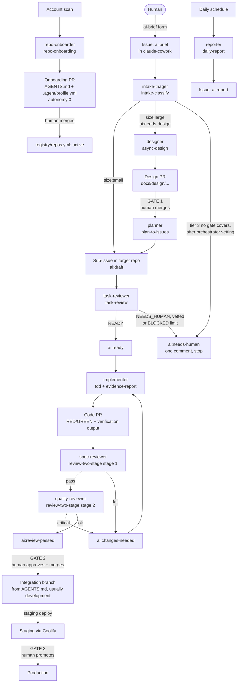

# Architecture

`claude-cowork` is the control plane for AI-driven development at `altaprimadev`.
Humans write briefs, watch progress, and approve at gates. Agents do the work.

## Principles

- **GitOps.** Configuration lives in this repo. State lives in GitHub: issues, labels, PRs, comments.
- **Cloud sessions.** Claude Code on the web runs each step in a fresh, short-lived container. Cloud scheduled tasks start the sessions, from a cron schedule or a GitHub event. `/loop` is never used for recurring work, because it stops with its container.
- **One agent identity.** A company Claude account plus a GitHub machine user. The agent does work. It never approves.
- **Integrity from the platform.** Branch protection, required checks, CODEOWNERS, and Coolify permissions enforce the gates. Prompts and hooks only add layers on top.

## Persona

`claude-cowork` is an autonomous agentic workflow. Every skill, agent, rule, and scheduled task keeps these invariants. `watchtower` audits against them (rubric "Persona").

1. **Agents work; humans gate.** A human writes the brief, merges at Gates 1, 2, and 3, merges onboarding PRs, and answers tier 3 escalations. Any other human step is friction to remove.
2. **Decide by default.** Agents settle open points themselves (`CLAUDE.md` -> "Decide by default"). A question a source or a reversible choice can settle is a defect.
3. **Flow without prompts.** Every label state has an automated next step, except at a gate. A human merge starts the next step without a human message (`pr-watch`).
4. **Resumable.** State lives in GitHub, not in chat or local files. A rerun posts no duplicate comment or issue (`<!-- ai:... -->` markers).
5. **Stop cleanly.** Every loop has a cap, and heavy stages check usage first. A stopped item shows in `inbox` or `pipeline-status`.
6. **Machine contracts.** Stage agents return a parseable result (a `verdict:` or `status:` line, such as `PASS`, `CHANGES_NEEDED`, `NEEDS_HUMAN`, `BLOCKED`), not free prose.
7. **Autonomy inside limits.** Speed never relaxes a gate, the autonomy level, or a "never" rule.

## Layers

| Layer | Lives in | Role | Can it be bypassed by the agent? |
|---|---|---|---|
| 1. Platform | GitHub settings, Coolify, AWS IAM | Absolute integrity: approvals, required checks, protected branches, deploy permissions | No. The machine user has no admin rights. |
| 2. Hook | `.claude/hooks/guard_bash.py` (+ org managed settings) | Second safety layer: blocks destructive Bash commands | Partly. It is pattern based. Layer 1 still holds. |
| 3. Orchestrator | `CLAUDE.md` | Global rules, stage → agent → skill routing | Instruction only |
| 4. Fixed agents | `.claude/agents/` | One role per pipeline stage, least-privilege tools | Instruction plus tool allowlist |
| 5. Skills | `.claude/skills/` | Procedures per stage, plus stack knowledge loaded per repo | Instruction only |

Current gap: `altaprimadev` is a personal account without Pro, so layer 1 branch protection is not active yet. `CLAUDE.md` caps autonomy at 0 for unprotected repos, unless a human marks the repo `branch_protection: unavailable`; then compensating rules apply. See `docs/setup.md`, "Current state".

Note: in multi-repo hosted sessions, repo hooks and permission rules do not load. Layer 2 must also be installed as an org server-managed hook. See `docs/open-questions.md` (Q4) and `docs/setup.md`.

## Flow

Agents never write to the GitHub Project board. After a label change they dispatch `.github/workflows/project-sync.yml`, which runs `scripts/project_sync.py` to mirror issue state into the board. An hourly run catches up on missed dispatches. Status mapping: `docs/labels-and-states.md`.

## Session model

- Every agent session uses `claude-cowork` as the **main repo**. The target repo is an **additional repo**.
- The main session is the **orchestrator**. It reads GitHub state and `registry/`, then delegates to one fixed agent.
- Each fixed agent preloads its core skill through the `skills:` frontmatter field. Agents that touch code also load the stack packs listed in the target repo's `.agent/profile.yml` -> `packs`.
- Every SKILL.md frontmatter states `name`, `description` (what the skill does), `when_to_use` (when to use it and when not), `disable-model-invocation`, `model`, and `effort`. Stack packs skip `model` and `effort`. A skill's `model` and `effort` apply to the rest of the invoking turn, so skills the orchestrator calls mid-run use `opus` and `high`. `watchtower` checks the fields and values (`.claude/skills/watchtower/references/rubric.md`, Skills item 10).
- Reviewers run as separate subagents with fresh context. They are read-only and return findings to the orchestrator. The orchestrator posts the comment and sets the label.
- Each scheduled task and its prompt is defined in `docs/scheduled-tasks.md`.

## Gates

| Gate | Decision | Who | Platform enforcement |
|---|---|---|---|
| Gate 1 | Accept a design | Human merges the design PR | Branch protection, CODEOWNERS |
| Gate 2 | Accept code | Human approves the code PR | Required approval, required checks, dismiss stale reviews |
| Gate 3 | Release to production | Human promotes in Coolify, or merges to a protected `production` branch | Coolify permissions, branch protection |

No skill owns Gate 3. Agents may change Dockerfiles and deploy config through a normal PR. They never trigger a production deploy and never call Coolify or AWS APIs to deploy.

## Autonomy

The effective level is the lower of the `registry/repos.yml` value and the target repo's `.agent/profile.yml` value.

| Level | Allowed |
|---|---|
| 0 | Review and comment only. Onboarding always starts here. |
| 1 | `size:small` tasks and trivial changes. |
| 2 | Full pipeline, including design and planning. |

Humans raise the level through a PR to `registry/repos.yml` and the repo's profile.

## Repo registry and profiles

- `registry/repos.yml`: managed repos, their status, autonomy, and environment.
- `registry/policy.yml`: global limits (parallel sessions, tasks per repo, trivial-change size, fix attempts) and gates.
- `<target>/.agent/profile.yml`: stack, packs, commands, test types, coverage scope, deploy targets, autonomy, dependencies. Template: `templates/profile.yml`.
- `<target>/AGENTS.md`: repo map for agents. Template: `templates/AGENTS.md`.

## Environments

- **Hosted (default):** Anthropic-hosted cloud environment. It has no command sandbox. Isolation comes from the per-session VM, the network allowlist, minimal secrets, and branch protection.
- **Self-hosted:** only for repos that need a private network or heavy builds. Run the runner with `--trust-workspace false`. Put allow rules and the guard hook in the host's `~/.claude/settings.json`.
