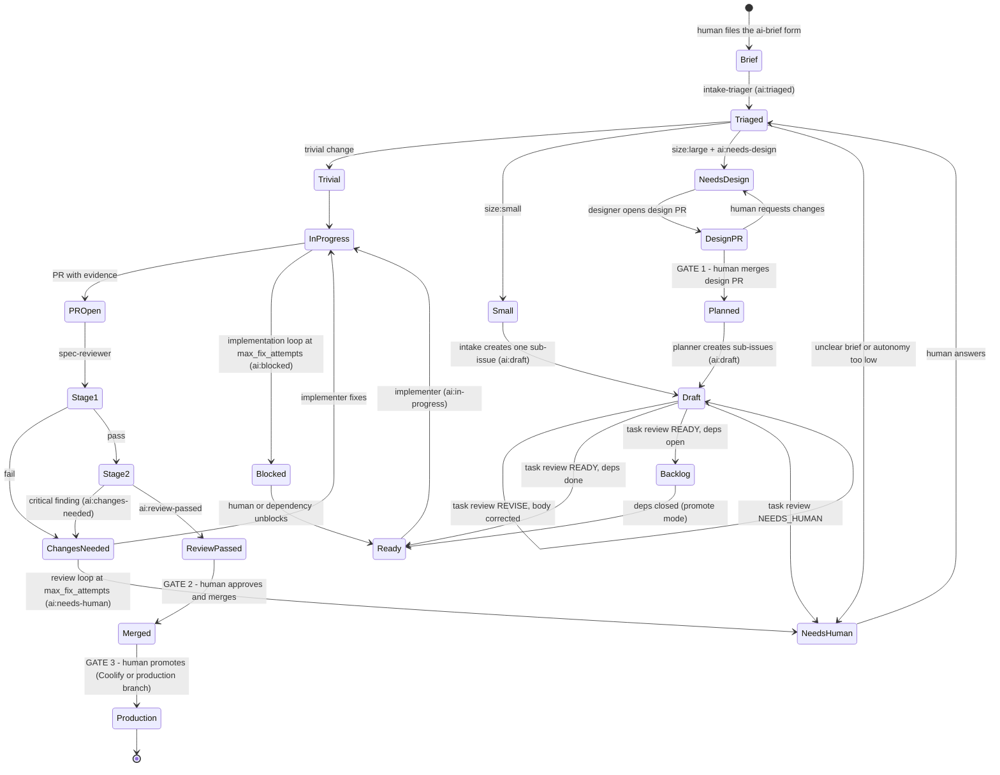

# Labels, states, and gates

GitHub is the state store. Labels show where each issue or PR is in the pipeline.
`scripts/setup-labels.sh` creates every label below. Humans run it.

## Labels

| Label | Meaning | Set by |
|---|---|---|
| `ai:brief` | New brief from a human | Brief form (`.github/ISSUE_TEMPLATE/ai-brief.yml`) or the `draft-brief` skill |
| `ai:triaged` | Brief classified | `intake-triager` |
| `size:small` | Small task: no design | `intake-triager` |
| `size:large` | Large task: design first (Gate 1) | `intake-triager` |
| `ai:needs-design` | Waiting for a design document | `intake-triager` |
| `ai:draft` | Task drafted; waiting for task review | `intake-triager` (small), `planner` (large) |
| `ai:ready` | Reviewed and ready to implement; dependencies done | Orchestrator after `task-review`, `planner` promote mode |
| `ai:in-progress` | A session works on it | Orchestrator, when it starts `implementer` |
| `ai:review-passed` | Agent review passed; waiting for human approval (Gate 2) | Orchestrator, after `review-two-stage` |
| `ai:changes-needed` | Agent review found blocking findings | Orchestrator, after `review-two-stage` |
| `ai:needs-human` | A tier 3 decision or a hard limit (`CLAUDE.md` → "Decide by default"); the item stopped | Orchestrator, after vetting |
| `ai:blocked` | Blocked by a dependency or a repeated error | Any agent |
| `ai:report` | Daily report issue | `reporter` |

Rules:

- An issue has at most one of `ai:draft`, `ai:ready`, `ai:in-progress`, `ai:blocked`, `ai:needs-human` at a time.
- Every label change comes with a comment that says why.
- A human clears `ai:needs-human` by answering in a comment and removing the label. The next scheduled run picks the issue up again.
  - The `answer` skill (`/answer <ref>`) does both from chat. It also sets the labels each stage needs to resume, for example `ai:ready` on a sub-issue.
  - Briefs re-enter intake only when `ai:triaged` is removed too. `answer` removes it.
  - Autonomy, registry, and branch-protection blockers cannot be cleared by a comment. They need a PR or a platform change.
- Only humans approve and merge. Labels never replace an approval.

## State machine

## GitHub Project board

`.github/workflows/project-sync.yml` mirrors issue state into the GitHub Project set in `registry/policy.yml` → `project`. It runs hourly and on dispatch. Agents read and write issues and labels only. The Project is a view.

| Status option | Issue state (first match wins) |
|---|---|
| Done | Closed |
| In review | `ai:needs-human`: a human must review or decide |
| Blocked | `ai:blocked` |
| Ready to merge | An open PR that closes the issue (`Closes #n`) carries `ai:review-passed`. Gate 2 waits for a human. |
| In progress | `ai:in-progress`, or a triaged brief (`ai:brief` + `ai:triaged`) whose work moved to a design PR or sub-issues |
| Ready | `ai:ready` |
| Draft | `ai:draft` |
| Design | `ai:needs-design` |
| Brief | `ai:brief` without `ai:triaged` |
| Backlog | `ai:plan` marker or `Parent:` line, no stage label |

## Gates

| Gate | What | Who | Enforced by |
|---|---|---|---|
| Gate 1 | Design accepted | Human merges the design PR | Branch protection: PR, approval, CODEOWNERS |
| Gate 2 | Code accepted | Human approves the code PR | Branch protection: approval, required checks, dismiss stale reviews. Repos with `branch_protection: unavailable`: the guard hook, the `deny` rules, and a human merge (`CLAUDE.md`, compensating rules) |
| Gate 3 | Production release | Human promotes in Coolify or merges to the protected production branch | Coolify permissions, branch protection on `production` |

Agents never pass a gate. As a second layer, `.claude/hooks/guard_bash.py` blocks merge, approve, workflow-run, and force-push commands, and pushes to the branches in `guard_bash.config.json` -> `protected_branches`. The `deny` rules in `.claude/settings.json` block the GitHub MCP tools that merge, approve, run workflows, or write files directly.
