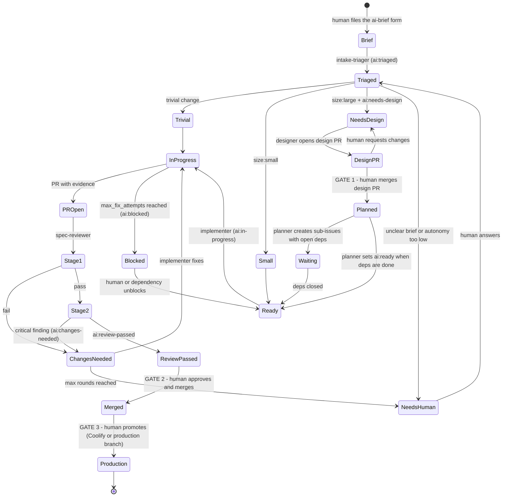

# Labels, states, and gates

GitHub is the state store. Labels show where each issue or PR is in the pipeline.
`scripts/setup-labels.sh` creates every label below. Humans run it.

## Labels

| Label | Meaning | Set by |
|---|---|---|
| `ai:brief` | New brief from a human | Brief form (`.github/ISSUE_TEMPLATE/ai-brief.yml`) |
| `ai:triaged` | Brief classified | `intake-triager` |
| `size:small` | Small task: no design | `intake-triager` |
| `size:large` | Large task: design first (Gate 1) | `intake-triager` |
| `ai:needs-design` | Waiting for a design document | `intake-triager` |
| `ai:ready` | Ready to implement; dependencies done | `intake-triager` (small), `planner` (large) |
| `ai:in-progress` | A session works on it | Orchestrator, when it starts `implementer` |
| `ai:review-passed` | Agent review passed; waiting for human approval (Gate 2) | Orchestrator, after `review-two-stage` |
| `ai:changes-needed` | Agent review found blocking findings | Orchestrator, after `review-two-stage` |
| `ai:needs-human` | A human must decide; the session stopped | Any agent |
| `ai:blocked` | Blocked by a dependency or a repeated error | Any agent |
| `ai:report` | Daily report issue | `reporter` |

Rules:

- An issue has at most one of `ai:ready`, `ai:in-progress`, `ai:blocked`, `ai:needs-human` at a time.
- Every label change comes with a comment that says why.
- A human clears `ai:needs-human` by answering in a comment and removing the label. The next scheduled run picks the issue up again.
- Only humans approve and merge. Labels never replace an approval.

## State machine

## Gates

| Gate | What | Who | Enforced by |
|---|---|---|---|
| Gate 1 | Design accepted | Human merges the design PR | Branch protection: PR, approval, CODEOWNERS |
| Gate 2 | Code accepted | Human approves the code PR | Branch protection: approval, required checks, dismiss stale reviews |
| Gate 3 | Production release | Human promotes in Coolify or merges to the protected production branch | Coolify permissions, branch protection on `production` |

Agents never pass a gate. As a second layer, `.claude/hooks/guard_bash.py` blocks merge and approve commands and pushes to `main`, `master`, and `production`.
